<!-- Cards are generated by tools/build_assets.py (stats by tools/build_stats.py); edit the content there and re-run. -->

<a href="https://yoosufahamed.com"><picture><source media="(prefers-color-scheme: light)" srcset="assets/light/header.svg"></picture></a>

<a href="https://github.com/YOOSUF-HUB"><picture><source media="(prefers-color-scheme: light)" srcset="https://timeline-readme.vercel.app/api/timeline?user=YOOSUF-HUB&bg=ffffff&accent=8c8c8c&hot=404040&glint=0a0a0a&line=e4e4e4"></picture></a>

<picture><source media="(prefers-color-scheme: light)" srcset="assets/light/section-01.svg"></picture>

<picture><source media="(prefers-color-scheme: light)" srcset="assets/light/terminal.svg"></picture>

<picture><source media="(prefers-color-scheme: light)" srcset="assets/light/section-02.svg"></picture>

<a href="https://github.com/YOOSUF-HUB/Open-Analyst"><picture><source media="(prefers-color-scheme: light)" srcset="assets/light/tile-open-analyst.svg"></picture></a>
<a href="https://github.com/YOOSUF-HUB/idea-forge"><picture><source media="(prefers-color-scheme: light)" srcset="assets/light/tile-idea-forge.svg"></picture></a><a href="https://github.com/YOOSUF-HUB/API-Sentinel-AI-"><picture><source media="(prefers-color-scheme: light)" srcset="assets/light/tile-api-sentinel.svg"></picture></a>
<a href="https://github.com/YOOSUF-HUB/AI-Project-Manager-MCP-Server"><picture><source media="(prefers-color-scheme: light)" srcset="assets/light/tile-mcp-pm.svg"></picture></a><a href="https://github.com/YOOSUF-HUB/Brain_Tumor_Classification_CNN"><picture><source media="(prefers-color-scheme: light)" srcset="assets/light/tile-brain-tumor.svg"></picture></a>

<picture><source media="(prefers-color-scheme: light)" srcset="assets/light/section-03.svg"></picture>

<picture><source media="(prefers-color-scheme: light)" srcset="assets/light/pipeline.svg"></picture>

<picture><source media="(prefers-color-scheme: light)" srcset="assets/light/section-04.svg"></picture>

<picture><source media="(prefers-color-scheme: light)" srcset="assets/light/stack.svg"></picture>

<picture><source media="(prefers-color-scheme: light)" srcset="assets/light/section-05.svg"></picture>

<picture><source media="(prefers-color-scheme: light)" srcset="assets/light/stats.svg"></picture>

<picture><source media="(prefers-color-scheme: light)" srcset="assets/light/section-06.svg"></picture>

<a href="https://yoosufahamed.com"><picture><source media="(prefers-color-scheme: light)" srcset="assets/light/connect.svg"></picture></a>

<a href="https://yoosufahamed.com"><picture><source media="(prefers-color-scheme: light)" srcset="assets/light/chip-site.svg"></picture></a> <a href="https://github.com/YOOSUF-HUB"><picture><source media="(prefers-color-scheme: light)" srcset="assets/light/chip-github.svg"></picture></a> <a href="https://www.linkedin.com/in/yoosuf-ahamed/"><picture><source media="(prefers-color-scheme: light)" srcset="assets/light/chip-linkedin.svg"></picture></a> <a href="mailto:yahamed95@gmail.com"><picture><source media="(prefers-color-scheme: light)" srcset="assets/light/chip-email.svg"></picture></a>
